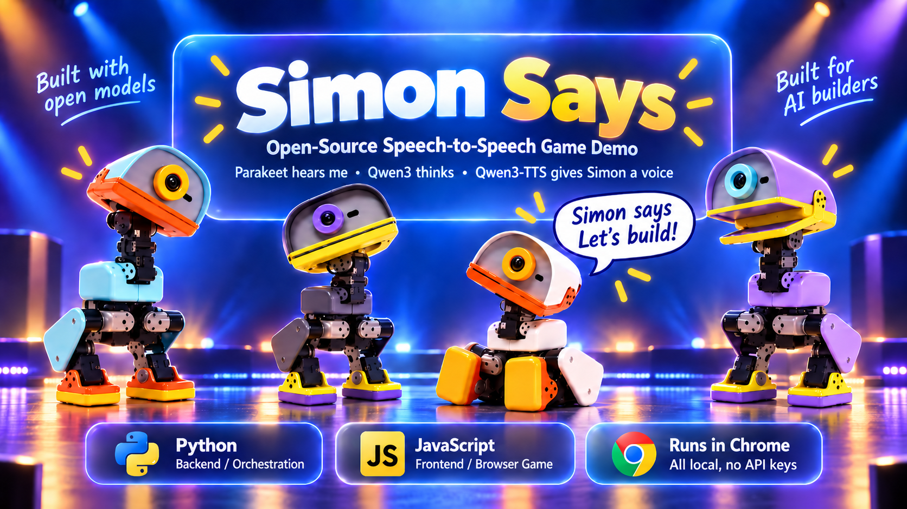

# Simon Says with Microduck



**A tiny robot duck. A cheeky voice. A game you already know.**

Meet Simon: a virtual [Microduck](https://pollen-robotics.com/microduck/blog/introducing-microduck/) from Pollen Robotics. He calls the moves, tries to catch you out, and celebrates when he wins. Your webcam is the referee.

Open models running on a Mac give Simon his voice and personality. Chat between games, then play seated at your desk, with head turns and raised arms.

## One round with Simon

| Simon says… | Your move | What happens |
| --- | --- | --- |
| **“Simon says, look left.”** | Look left and hold it. | The webcam checks your move. You’re through! |
| **“Raise both arms!”** | Stay still. He didn’t say Simon says. | Nice try, Simon. |
| **“Simon says, raise your right arm.”** | Raise your left arm instead. | He catches you out — and gets his moment to gloat. |

Get all five rounds right to win a game. Make a mistake and Simon wins. The scoreboard keeps your running totals, and he asks for a rematch.

Before you play, camera setup helps you face forward and leave enough room for your arms. Moves must be held for a second; the response timer starts after Simon finishes the command. If you leave the camera’s view mid-round, that round doesn’t count.

Simon has no arms, so he can call arm moves but can’t demonstrate them. 

## Fair rules. Plenty of personality.

**The browser runs the game.** Code chooses commands and traps, checks poses, and records the result. Simon’s language model doesn’t decide whether you won.

**The voice makes it feel alive.** Qwen3-TTS gives Simon his expressive Aiden voice. Repeated commands and score lines use saved, checked audio, avoiding fresh generation on every turn. If a command can’t be spoken cleanly, the game skips it rather than judging you against a broken instruction.

**Conversation leaves room for surprise.** Between games, a local voice agent handles chat. Generated reactions add variety, while head movements, quacks, and a moving beak bring the simulated duck to life.

Speech processing runs on your Mac; webcam pose tracking runs in your browser. No cloud inference or API keys. Model downloads and CDN-hosted pose assets still need internet access.

## Run it on your Mac

Tested on Apple Silicon: M3 Pro, 18 GB memory. The voice agent uses roughly 8 GB; its models download on first use.

You'll need:

- An Apple Silicon Mac (the voice agent runs on MLX)
- Google Chrome, a webcam and a microphone (headphones recommended)
- [uv](https://docs.astral.sh/uv/) and Git
- Node.js with npm, to build the simulator once

```bash
git clone https://github.com/LizMyers/micro-duck.git
cd micro-duck
./setup.sh
uv run duck-lab
```

`setup.sh` installs Hugging Face [speech-to-speech](https://github.com/huggingface/speech-to-speech) (the voice agent) and builds Pollen Robotics' [Microduck simulator](https://huggingface.co/spaces/pollen-robotics/microduck-simulator) with this repo's patch. Both go in folders next to this repo, and it's safe to run again. Until the [tool-call fixes (PR #721)](https://github.com/huggingface/speech-to-speech/pull/721) are merged upstream, it installs speech-to-speech from the PR's branch.

Instead of `uv run duck-lab`, you can double-click **Duck Lab.command** in Finder. The launcher opens **http://localhost:8770/play** and starts the voice agent. Wait for **READY**, complete camera setup, and press **Play!**

For conversation, tap the talk button or hold Space. For diagnostics, open **http://localhost:8770**. If your dependency folders are elsewhere, set `S2S_DIR` and `SIM_DIST`; see [running the lab](notes/running-the-lab.md) for logs and restart controls.

## How it works


All components run on one Mac. The browser connects directly to the speech agent over a local WebSocket; FastAPI serves the app and manages the agent process.

**The browser owns the game.** MediaPipe supplies player poses to deterministic JavaScript rules. Fixed voice lines replay from the browser cache; missing lines and improvised reactions use the speech agent. Webcam video stays in the browser.

**Movement tools are enabled in Duck Lab (`/`).** The game page (`/play`) offers the `play_simon_says` tool and controls the duck's head and beak locally. In Duck Lab, JavaScript acknowledges that a movement has started, checks simulator state, and reports failures to the agent. The duck is a browser simulation.

- **Speech-to-speech pipeline.** Hugging Face's [speech-to-speech](https://github.com/huggingface/speech-to-speech) runs as a local Python server with models from the Hub: Parakeet for speech to text, Smart Turn for end-of-turn detection, Qwen3 4B as the language model and Qwen3-TTS for the voice. The browser talks to it over the OpenAI Realtime protocol.
- **Voice and latency.** Qwen3-TTS is slower than Kokoro, so we save the audio for fixed game lines. After the first take, every command and score line plays instantly.
- **Game logic in plain JavaScript.** The browser runs the game: rounds, timing, scoring and the nine commands. Game lines are sent as out-of-band responses, so they never grow the model's conversation history.
- **Turn-taking.** The mic stays open for the whole session. Smart Turn decides when you've finished speaking from how you stopped, not just from silence. If you speak during a reply, the reply pauses rather than being dropped.
- **Webcam referee.** MediaPipe pose tracking compares each move to your starting stance. A move only counts if you hold it for a second, and 57 unit tests cover the rules, including mirrored left and right. Video never leaves your laptop.
- **Moves as tools.** In Duck Lab, the robot's 11 moves (step, turn, sit, bow, kick, skates and more) are exposed to the model as tools. JavaScript drives Pollen's trained walking policies and checks the resulting simulator state. The model receives a start acknowledgement; if a movement fails, JavaScript sends failure feedback and requests a spoken explanation.

<details>
<summary><strong>Models and where things live</strong></summary>

| Part | Responsibility |
| --- | --- |
| Silero VAD + Smart Turn | Speech activity and turn detection |
| Parakeet TDT 0.6B v3 | Speech to text via MLX |
| Qwen3 4B Instruct | Local conversation and tool calls |
| Qwen3-TTS 1.7B CustomVoice | Speech and saved voice lines |
| MediaPipe Pose Landmarker | Browser webcam referee |
| MuJoCo + ONNX policies | Microduck simulation and movement |
| FastAPI + speech-to-speech | Local server and voice-agent connection |

| Path | What it does |
| --- | --- |
| `lab/server.py` | Starts the voice agent and serves the game, the simulator and the moves |
| `lab/static/simon-says.js` | The game: rounds, rules, scoring |
| `lab/static/pose.js` | Pose tracking that checks your moves |
| `lab/static/voice-lines.js` | Saved voice lines |
| `lab/static/turn-taking.js` | Turn-taking and interruptions |
| `lab/static/duck-tools.js` | The robot's moves, as tools the model can call |
| `lab/static/duck-body.js` | Head poses, beak and camera |
| `lab/static/play.js` | The game page |
| `notes/` | The build diary: decisions, timings and what we learned |

The Inspector shows messages, movement traces, and voice timings.

Run the game and pose tests with `node --test lab/static/tests/*.test.mjs`.

</details>

## Fixes sent upstream

Building a real game on speech-to-speech with a small local model surfaced tool-calling bugs: the agent lost a tool call, or read tool-call markup aloud. [PR #721](https://github.com/huggingface/speech-to-speech/pull/721) fixes two of them, with unit tests:

1. **Native `<tool_call>` blocks were spoken.** After a few tool turns, Qwen switches to its native `<tool_call>{json}</tool_call>` syntax, and the block went straight to the voice. Now it's parsed as a tool call.
2. **Tool markup was spoken when tools were off.** A reply with `tool_choice: "none"` could still contain a tool call, which was read aloud. Now it's stripped from speech and never run.

A third bug, positional arguments being dropped (`turn_left(360)` lost its value), had already been fixed upstream in #579.

## Credits

[Microduck and its simulator](https://huggingface.co/spaces/pollen-robotics/microduck-simulator): Pollen Robotics. Voice pipeline: [Hugging Face speech-to-speech](https://github.com/huggingface/speech-to-speech). Pose tracking: [MediaPipe](https://ai.google.dev/edge/mediapipe). Community bow policy: [fffiloni](https://huggingface.co/fffiloni/microduck-polite-bow-b1d864).

This repo includes a simulator patch, not the simulator itself. See [sim/README.md](sim/README.md) for setup and licence notes. Licensed under [Apache 2.0](LICENSE).

Made by [Liz Myers](https://lizm.dev/#microduck), with Claude.
